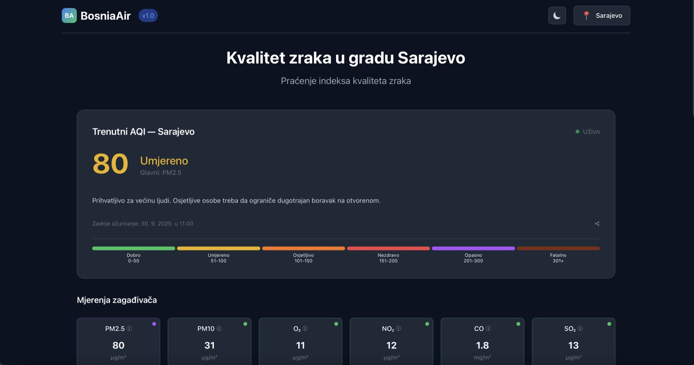

# BosniaAir

Real-time air quality for cities in Bosnia and Herzegovina, with forecasts and health advice.

**Live:** [bosniaair.vercel.app](https://bosniaair.vercel.app)



## Why

In winter the air in Sarajevo and other Bosnian cities is among the worst in Europe, but the raw numbers
are hard to read. BosniaAir puts the current AQI, the dominant pollutant, the forecast for the next days
and plain advice for sensitive groups on one screen, per city, sized for a phone in the morning.

## What it does

- Live AQI and pollutant levels (PM2.5, PM10, O3, NO2, CO, SO2) for Sarajevo, Tuzla, Zenica, Mostar, Travnik and Bihać
- Daily forecast for PM2.5, PM10 and O3
- Health advice for the general population and sensitive groups, based on the current AQI
- City comparison, a saved primary city, light and dark theme
- A small public JSON API (below)

## How it works

```
Browser (Next.js + React, SWR)
   │  /api/v1/...
   ▼
Next.js route handlers on Vercel ──► WAQI API (a primary station per city, nearest live one as fallback)
   (responses cached 5 min in the Next.js Data Cache)
```

The frontend and the API are one Next.js deployment on Vercel. The route handlers in
`frontend/app/api/v1` fetch each city's WAQI station, normalise the data and cache it for five minutes,
so the upstream API is hit at most a few times per city per five minutes no matter how many people open the page.
The client refreshes with SWR and an observable that keeps all panels in sync.

If a city's primary station has not reported for more than 6 hours, the API uses the nearest station
within 40 km of the city centre that has (WAQI map bounds, all networks), and says so in `source`
(the UI then shows "izvor: <station>, <distance> od centra"). If no station nearby reports, it serves the
last values with `source.stale: true`. Rules: `frontend/lib/server/stations.ts`, tests: `npm test`.

The first version had a separate .NET 8 API (ASP.NET Core, Entity Framework Core, SQLite and a background
scheduler). It lives in `backend/` for reference; the Next.js handlers return the same JSON shape.

## Public API

| Endpoint | Returns |
| --- | --- |
| `GET /api/v1/air-quality/{city}/live` | Current AQI, category, dominant pollutant, measurements, `source` (station used, fallback/stale flags) |
| `GET /api/v1/air-quality/{city}/forecast` | Daily forecast (PM2.5, PM10, O3); `available: false` and an empty list when there is none |
| `GET /api/v1/air-quality/{city}/complete` | Live and forecast in one call |
| `GET /api/v1/health` | Health check |

`{city}` is one of `Sarajevo`, `Tuzla`, `Zenica`, `Mostar`, `Travnik`, `Bihac` (case-insensitive).
Timestamps are UTC ISO 8601. CORS is open for GET.

```bash
curl https://bosniaair.vercel.app/api/v1/air-quality/sarajevo/live
```

## Stack

Next.js 14, React, TypeScript, Tailwind CSS, SWR, Vercel. Data from the
[World Air Quality Index project](https://aqicn.org). Legacy backend: .NET 8, ASP.NET Core, EF Core, SQLite.

## Run it locally

You need Node.js 18+ and a free WAQI token from [aqicn.org/data-platform/token](https://aqicn.org/data-platform/token/).

```bash
git clone https://github.com/iamelmirr/bosniaair.git
cd bosniaair/frontend
npm install
WAQI_API_TOKEN=your_token npm run dev
```

Open http://localhost:3000. The API runs in the same process under `/api/v1`.

## License

MIT, see [LICENSE](LICENSE).

---

Built by [Elmir Beširović](https://itselmotech.com/elmir).
